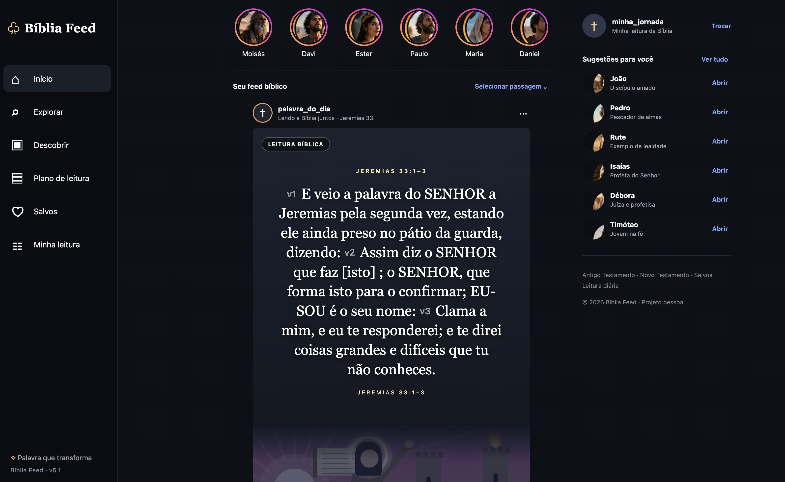

# Bíblia Feed 5.1 — Feed de layouts variados estilo Instagram

Leitor bíblico pessoal que abre no navegador, mas roda em um servidor Python local **sem instalar bibliotecas adicionais**.

<p align="center">
  
</p>

## Iniciar (macOS / Windows / Linux)

1. Clone o repositório e acesse a pasta do projeto:
   ```bash
   git clone https://github.com/juanalencarvagas/biblia_feed_instagram.git
   cd biblia_feed_instagram
   ```
2. Execute o servidor:
   - **macOS / Linux**: `python3 app.py`
   - **Windows**: `python app.py`
3. Abra `http://127.0.0.1:8765` no navegador (ou aguarde a aba abrir automaticamente).
4. Para encerrar: pressione `Ctrl+C` no terminal.

## Primeira execução

Na primeira inicialização o app tenta baixar:
- **Almeida Livre** (português, domínio público)
- **KJV / King James Version** (inglês, domínio público)

Depois disso, os arquivos ficam guardados na pasta do projeto (`almeida-livre.json` e `kjv.json`).

## O que há nesta versão

- Layout inspirado no Instagram Web.
- Menu lateral, stories bíblicos e sugestões na barra direita.
- **Feed com posts variados**: o visual muda de card para card para parecer mais orgânico.
- O texto central do versículo continua no estilo visual da versão 2.
- Rodapé com **tradução comparativa em inglês (KJV)** do mesmo trecho.
- Pesquisa bíblica, salvos, compartilhamento e reflexões pessoais.
- Layout responsivo para telas menores.

## Observações

- Os retratos de personagens são representações artísticas.
- O app é pessoal/local: não há contas reais, curtidas compartilhadas ou comentários públicos.
- Se a KJV não puder ser baixada na primeira vez, o app continua funcionando em português e mostra um aviso no bloco de comparação.

## Melhorias da versão 4.0
- Seis composições visuais diferentes: fotografia, editorial de papel, carrossel com slides navegáveis, retrato dividido, colagem e card de destaque.
- Fotos opcionais carregadas pela internet (Unsplash) com fundo local de reserva.
- Sem caixa de anotações/reflexões: removida.
- O texto Almeida Livre permanece no centro dos cards e a KJV abaixo de cada post.
- Os cards se ajustam ao texto, evitando a rolagem interna dos versículos.


## Atualização 5.0
- Cards com altura natural para não cortar passagens longas.
- Seleção automática de fotos temáticas a partir de palavras como orvalho, chuva, mar, floresta e fogo; carregadas via Unsplash quando há conexão.
- Quando não há foto disponível, os cards mantêm fundo ilustrativo local.
- Incluído `PROMPT_MESTRE_BIBLIA_FEED_4.md` na raiz do projeto.


## Versão 5.1

- Número da versão aparece no rodapé lateral, acima do feed em celulares e em Minha leitura.
- Dez ilustrações temáticas SVG locais acompanham a instalação, escolhidas por palavras do trecho.
- Imagens de personagens genéricos foram removidas dos cards de retrato, colagem e carrossel para evitar ilustrar indevidamente o texto.
- Mesmo sem internet, cada card dispõe de ilustração temática local.
- Identificador discreto de versículo (`v1`, `v2`, ...) no início de cada trecho nos cards.
- Navegação direta para o próximo capítulo no rodapé do último card da leitura.
